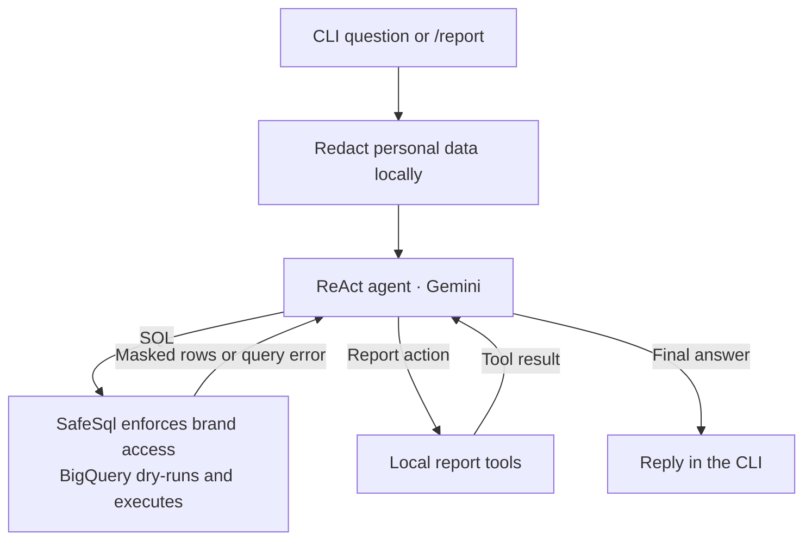

# Retail AI Agent

Ask a retail sales question in the terminal. Gemini queries the public theLook eCommerce dataset in BigQuery and answers for the brands the selected employee can see.

## How the prototype handles a question

Questions and `/report` go straight to one ReAct agent. On the first model call, Gemini can answer from the visible schema, ask for clarification or call a tool.



## Production architecture

The [docs/](docs/) directory describes the production-ready architecture. Start with the [high-level design](docs/HLD.md).

## Quick start

### Setup

Run the commands from the repository root with `uv`.

1. Create `.env`.
2. In `.env`, set `GOOGLE_AI_STUDIO_API_KEY` and `GEMINI_MODEL`. The example uses `gemini-3.5-flash-lite`. Set `GOOGLE_CLOUD_PROJECT` to a project with the BigQuery API enabled.
3. Run `gcloud auth application-default login` with an account that can create BigQuery jobs in that project.

On the first `uv run --locked`, uv sets up a Python 3.14 environment in `.venv` and installs the project dependencies.

### Start an interactive chat

Choose a user ID from the top-level keys in [config/users.json](config/users.json). Each profile defines which brands appear in its answers.

| User ID for `--user` | Visible brands |
| --- | --- |
| `manager_a` | Calvin Klein |
| `manager_b` | Levi's, Wrangler |
| `ceo` | All brands |

From the repository root, start a chat as `manager_a`.

```sh
uv run --locked retail-agent --steps --user manager_a
```

- `uv run --locked` runs the command in the project environment and stops if `uv.lock` is missing or needs updating.
- `--steps` shows the agent's progress for each question. Omit it for a quieter chat.
- `--user manager_a` selects the employee for this session. Replace `manager_a` with any ID in the table above. Omitting `--user` selects `DEFAULT_USER` (initially `manager_a`).

Chat appends one event per line to `DATA_DIR/trace.jsonl`, with or without `--steps`. With the default settings, run `tail -f .retail-agent/trace.jsonl` in a second terminal to watch events.

When the `>` prompt appears, type a question and press Enter. After each answer the prompt returns, so you can enter the next line in this example as a follow-up.

```text
What was completed revenue for my brand in January 2024?
How many distinct orders did that cover?
/report Summarize those sales and suggest one next action.
```

Type `/help` to list chat commands or `/exit` to quit. To switch users, exit and start the CLI again with a different `--user`. If you usually work as `manager_b`, set `DEFAULT_USER=manager_b` in `.env` and start the chat with `uv run --locked retail-agent --steps`.

### Ask a single question

```sh
uv run --locked retail-agent --steps --user manager_a "For January 2024, what was total completed item revenue for my brands? Give the total in USD and the period."
```

The quoted text is the question. Passing it on the command line makes the CLI answer once and exit. Omit the question to open the interactive prompt.

### Run the live eval

Run all 16 scenarios as `manager_a` using Gemini and BigQuery.

```sh
uv run --locked python -m evals.live --pause-seconds 12
```

`python -m evals.live` runs the project's live evaluation module. The optional `--pause-seconds 12` waits 12 seconds between scenarios to reduce the chance of hitting Gemini's request limit. Omit the flag for the default pause of 0 seconds.

The terminal prints Gemini's revenue and order-count answers, the failed checks and the final tally. A run recorded before the switch to direct ReAct calls scored **15/16 passed, 1 failed, 0 skipped**. Gemini answered **$359.54 across 5 orders** for January 2024. In `self-correction`, BigQuery returned the correct amount, but the final reply timed out. [Recorded run](evals/results/live.json)

Open `.retail-agent/eval-live.json` after the run.

| What to look for | Where in the JSON |
| --- | --- |
| Question and answer | Find the case by `id` in `cases`, then read `prompt` and `answer`. Saved reports also include `report_body`. |
| Figures behind the answer | Compare the case's `sql_candidates` and `sql_observations` with the independent BigQuery totals in `reference`. [Reference SQL](evals/reference.sql) |
| Why a case failed | Look for `false` in its `checks`. Skipped cases have a `reason`. If the run stopped early, read the top-level `error`. |
| Trace for a case | `cases[].trace` holds the run ID, latency, model calls, SQL attempts and estimated cost when available. The live eval deletes its temporary `trace.jsonl` after the run. |

### Demo users and data access

The CLI trusts the selected employee profile without a sign-in. The BigQuery `users` table contains customer records. All demo profiles use the same BigQuery credentials. The CLI enforces a manager's brand scope in `SafeSql` before joins and aggregation, without configuring BigQuery row access policies.

The CLI uses Presidio locally to redact personal data. Its recognizers can miss names or addresses and can mask brand names.

### Saved reports

`/report` starts with a 120-second deadline. You can also ask Gemini to create a report in plain language. When Gemini marks a SQL query for that report, the deadline extends from the usual 30 seconds to 120 seconds, measured from the start of the request. SQL corrections and model retries share the same budget.

Ask “Delete reports mentioning Client X” or use `/delete-conversation` to preview matching reports. Use `/select <action ID>` to see your available reports. To remove or add reports, append the complete list of IDs you want to delete. Review the updated selection and use `/confirm <current action ID>` or `/cancel <current action ID>`. History and pending confirmations last for the current process. After a restart, request a fresh preview.

<a id="storage-and-observability"></a>

Saved reports survive restarts. By default, `.retail-agent/reports/` holds the Markdown files and their `index.json`.

[Report prompts](src/retail_ai_agent/infrastructure/agent/prompts.py) · [Production architecture](docs/HLD.md) · [Saved reports design](docs/reports.md) · [Original assignment](task-description.md)
