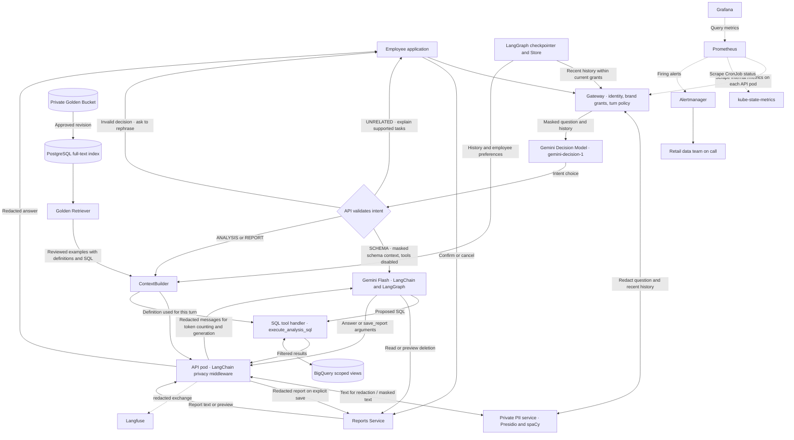

# Retail analytics assistant

A brand manager can ask why March sales fell, compare February and March, and save the findings as a Markdown report. The assistant can reuse a method from an analyst-reviewed example. Current figures come from the employee’s authorized rows in `bigquery-public-data.thelook_ecommerce` (`orders`, `order_items`, `products` and `users`).

## Assumptions

**The retailer already operates a Kubernetes cluster.** Its platform team provides a namespace, internal HTTPS ingress, DNS and TLS, an image registry, secret delivery and the scheduler. The delivery team supplies separate images and Kubernetes Deployments for the application and PII service, their Service manifests, three CronJob definitions, health checks and database migrations.

| Retailer-provided infrastructure | How the assistant uses it |
| --- | --- |
| Corporate OIDC provider and current employee-to-brand grants | The gateway verifies the access token and resolves which brands and conversations the employee may access. |
| BigQuery project, scoped warehouse readers and Gemini API access | The SQL tool handler submits jobs against protected views under the employee’s grants. Gemini receives redacted model requests. |
| Managed PostgreSQL | The database team provides separate staging and production databases, TLS credentials and backups. API replicas share checkpoints, report records and operation receipts. |
| Private S3-compatible Golden Bucket | The storage team provides restricted write access, conditional writes and recovery. Only the publication worker writes approved revisions. |
| Langfuse and the retailer’s monitoring stack | Langfuse hosts redacted traces and analyst review queues. In the reference setup, Prometheus scrapes API pods, kube-state-metrics exposes CronJob status, Grafana displays trends and Alertmanager routes alerts to the retailer’s on-call team. |

**The retailer has its own data team to maintain the assistant after handover.** It reviews the definitions and SQL in shared Golden examples, owns disclosure rules, investigates incidents and approves releases. An analyst on that team manually reviews each new or revised Golden case before the worker can publish it to the bucket.

## Architecture

The internal ingress terminates TLS and forwards requests to a ClusterIP Service. The Service routes to one of two ready API pods. Each runs the FastAPI gateway, employee chat and persona editor, `ContextBuilder`, agent loop and tool handlers in the same Python application. Gemini Flash proposes tool calls and writes the employee’s answer. LangGraph checkpoints the conversation so either pod can resume a turn paused for a deletion decision.

The gateway routes each new chat message with the **Gemini Decision Model** (`gemini-decision-1`). It sends the masked question and recent authorized history to the Gemini Decisions API with one `choice` question. The four options are `SCHEMA`, `ANALYSIS`, `REPORT` and `UNRELATED`. For example, the history lets the classifier interpret “save that as a report.” The API returns the selected option, its confidence and the probabilities for all four options. The gateway validates the choice before dispatch and counts the call against the turn’s time, model-call and cost limits. [Google’s Decisions API guide](https://aistudio.google.com/docs/decisions-api#choice)

New capabilities plug into the same ReAct loop. Developers register a typed LangChain tool and its handler. Gemini can then choose the tool, use its result to call another tool, or answer the employee. As the catalog grows, a tool selection step before the loop will choose the tools relevant to the request from those available to the employee. [Adding a tool](scalability.md#adding-a-tool)

The API calls a private PII service over HTTPS. Its replicas load the English spaCy model used by Microsoft Presidio, so the retailer can scale inference and roll out model updates independently of the application. Each redaction adds a network round trip to the turn.

Three Kubernetes CronJobs run commands from the application image outside chat requests. One publishes reviewed Golden cases, one extracts employee preferences and one samples runs for regression tests.

## Components and storage

| Component | What it reads or writes |
| --- | --- |
| Gateway and LangGraph checkpointer | The gateway resolves current corporate identity and brand grants. The PostgreSQL checkpointer keeps conversation state, evidence and report references, and pending actions. Reads recheck access. |
| LangGraph Store and persona editor | The Store holds each employee’s preferences in PostgreSQL, including how they define measures in their own analyses. The editor publishes the active report style. `ContextBuilder` reads both when a turn starts. |
| SQL tool handler | A Python function behind `execute_analysis_sql(sql)` in each API pod. It checks the proposed SQL against the turn’s metric rules where defined, applies brand scope before aggregation, dry-runs it for cost, then executes it under a scoped warehouse identity. It records the released rows, query ID and metric definition so a reported figure can be traced to its source. [Active-customer example](agent-runtime.md#checking-an-active-customer-count) · [Warehouse access](security.md#identity-and-brand-access) |
| Golden Retriever and publication worker | Each approved case in the private S3-compatible Golden Bucket includes the analyst’s definition alongside the question, SQL and report. The worker indexes the revision in PostgreSQL. The retriever selects eligible examples by brand, metric and schema compatibility. |
| Reports Service | On an explicit save, the service rechecks brand access and commits the redacted Markdown, SQL and evidence references, and a receipt in PostgreSQL. Deletion uses a separate plan containing the exact IDs the employee confirms. |
| Private PII service | Returns masked text to the caller. The SQL tool handler enforces column and cohort rules before releasing BigQuery results. [PII service and result filtering](security.md#private-pii-service) |

## Capacity and release targets

Plan for about 100 active managers asking ten questions each per day. The starting load test uses one incoming request per second, or about 60 concurrent turns if each takes one minute. Target 10–30 seconds for a question and 1–2 minutes for a report, with a configurable $1 budget per turn.

Before rollout, CI compares the current and candidate releases on the same frozen BigQuery fixture. The proposed gates are at least 90% verified analytical task success, zero critical disclosures or unapproved deletions, and measured latency and cost within budget. [Evaluation and release criteria](evaluation-and-observability.md#evaluating-a-release)

## Implementation guides

- [Agent runtime and tool contracts](agent-runtime.md) · [Brand access and disclosure](security.md)
- [Report storage and deletion](reports.md) · [Employee preferences and Golden Knowledge](learning.md)
- [Budgets and recovery](operations.md) · [Extending and scaling the application](scalability.md)
- [Prometheus metrics, Langfuse traces and release criteria](evaluation-and-observability.md)
