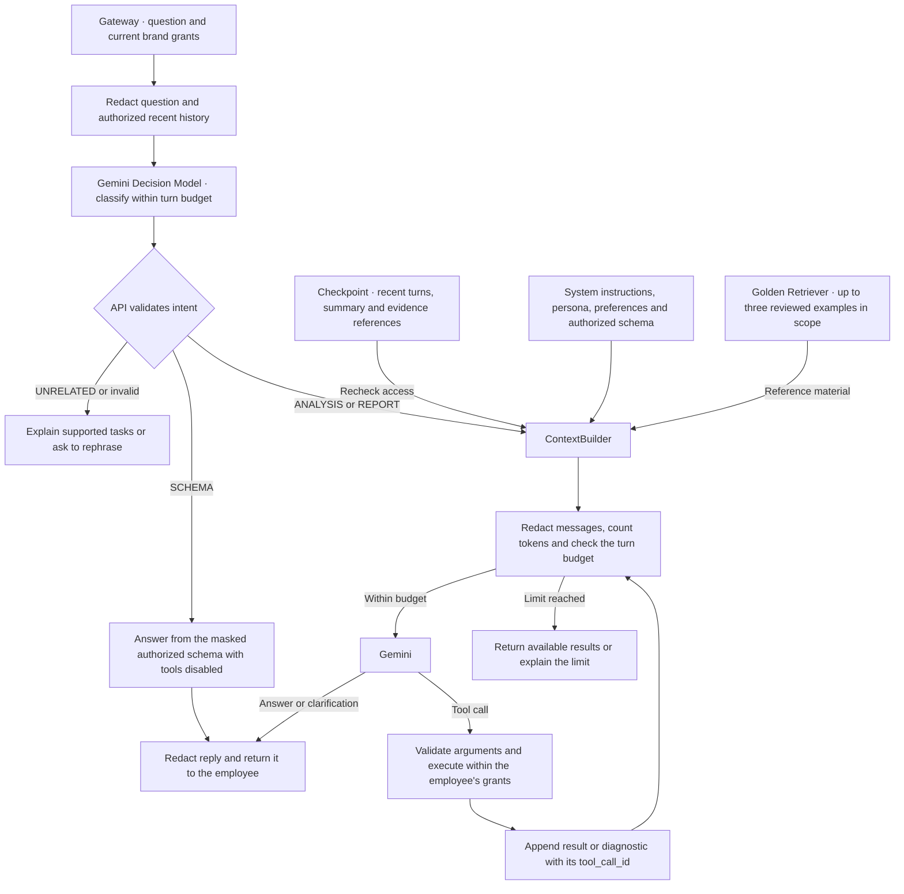

# Agent runtime and tools

## From a question to an answer

1. The gateway authenticates the employee and binds the conversation, brand grants and request budget to the turn. For a natural-language message, the Gemini Decision Model classifies the masked question with recent authorized history and returns one intent. `SCHEMA` answers from the authorized schema with tools disabled. `ANALYSIS` covers retail questions, follow-ups and requests about existing reports. `REPORT` means the employee explicitly asked to create or save a report and selects the longer deadline, including time already spent. `UNRELATED` returns a fixed reply describing supported tasks. If the decision is malformed, the API asks the employee to rephrase before any tools run. A confirmation or cancellation goes directly to the Reports Service.
2. `ContextBuilder` restores history, reads the employee’s preferences and loads the authorized schema. The Golden Retriever supplies up to three eligible analyst-reviewed examples. The application redacts this context before sending it to Gemini. The assistant uses the question, preferences and examples to resolve the metric and asks for clarification when needed. [Choosing a definition](learning.md#choosing-a-definition-for-a-question)
3. Gemini proposes GoogleSQL. The SQL tool handler validates one read-only statement with SQLGlot and checks its calculation, dates and filters against the definition selected for this turn. It applies brand scope before joins and aggregation, dry-runs the query, then executes it within the byte, time and row limits. Only the permitted result goes back to Gemini. [Warehouse access](security.md#identity-and-brand-access)
4. The SQL tool handler records the query ID, owner, brand scope, definition used, its source and the released rows as evidence in PostgreSQL. Gemini uses those results to write the answer. The privacy middleware redacts the response before the app displays it. A breakdown may show which category contributed to a decline. A claim about its cause needs separate evidence.
5. The checkpoint keeps the conversation and references to queries and reports. When the employee asks to save the analysis, the Reports Service verifies the request and stores the redacted Markdown with its SQL and evidence references. [Report storage](reports.md)

## Production tool contracts

The application supplies the employee and conversation IDs. The model supplies the arguments below.

| Tool | What the handler does |
| --- | --- |
| `execute_analysis_sql(sql)` | Run the scoped query and return the checked result or a diagnostic the agent can act on. |
| `search_golden_knowledge(query)` | Retrieve eligible reviewed examples, including the definition and SQL used in each case. |
| `read_report(report_id, section_id?)` | Read an accessible report or one section by ID. |
| `save_report(title, body_markdown)` | Save the requested analysis with the question, executed SQL and supporting evidence. |
| `prepare_delete_reports(search?, conversation_only?, report_id?, all_reports?)` | Preview reports matching a literal phrase, this conversation, one ID or an explicit whole-library request. |
| `update_user_preferences(op, field, value?)` | Set or clear an employee preference, including a personal definition for recurring analyses, in the PostgreSQL-backed store. |
| `write_todos` | Update the plan through LangChain’s to-do middleware. |

For “Delete reports mentioning 50%_off from this conversation,” the agent sends `{"search":"50%_off","conversation_only":true}`. The employee reviews the exact IDs. Selection changes, confirmation and cancellation go directly from the authenticated app to the Reports Service. [PostgreSQL selection and confirmation](reports.md#postgresql-implementation)
