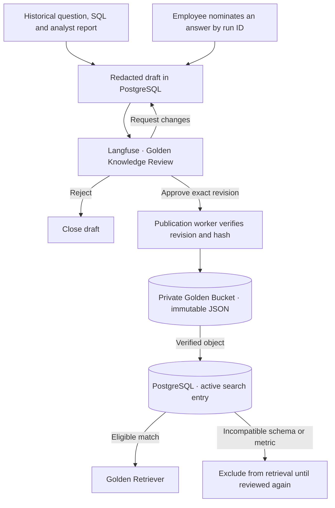

# Learning and knowledge management

## Golden Knowledge

When a manager asks why sales fell, the Golden Retriever can supply a similar analysis that a retail analyst has reviewed. It searches a PostgreSQL full-text index. The private Golden Bucket holds the approved source revisions from which that index can be rebuilt.

1. **Import or nominate.** Historical question–SQL–report examples and useful employee analyses enter the same review queue. The worker strips customer rows and identifiers, redacts free text, checks the SQL against the schema and deduplicates by content hash. It saves a draft under `(case_id, revision)` in PostgreSQL.
2. **Review the evidence.** The worker sends the redacted draft to the Golden Knowledge Review queue in Langfuse and records the trace ID, queue item ID and content hash on the draft. An analyst checks that the case explains what the measure counts, the SQL implements that calculation and the figures support the conclusions. Approval applies only to the revision they reviewed. An edit needs another review. A rejection closes the draft.
3. **Publish the approved revision.** The worker polls completed reviews and writes the approved JSON to `golden/<case_id>/<revision>.json` in the private bucket. The object contains the question, metric definition, parameterized SQL, report, analytical method, brand scope and compatible schema version. On retry, the worker checks the existing object’s hash against the reviewed draft. A mismatch stops publication.
4. **Make it searchable.** After verifying the object, the worker activates its PostgreSQL index entry in a transaction. If indexing fails, the previous eligible revision stays searchable while the worker retries. The GIN full-text index covers the question, metric names and method.
5. **Use it on a turn.** The Golden Retriever filters to active revisions compatible with the question and schema and within the employee’s brand grants. It ranks those matches by text relevance. `ContextBuilder` receives up to three examples with their definitions, IDs and revisions. The agent can reuse the grouping or comparison and runs fresh SQL in BigQuery.

If the retailer changes a metric or drops a column used by a case, the historical object stays in the bucket. Retrieval excludes the incompatible revision. An analyst can update the SQL and report, review the new revision and publish it through the same path.

## Choosing a definition for a question

A manager can say “For my reports, an active customer means someone who completed a purchase in the last 60 days.” The assistant saves that definition in the manager’s preferences in PostgreSQL. A Golden Bucket case can document a 90-day window used by an analyst for a retention report. Each definition stays with the preference or case where it was recorded.

An explicit window in the current question takes precedence. For “my usual active customers,” the assistant uses the manager’s 60-day preference. For “repeat the retention report,” it uses the reviewed case’s 90-day window. If both readings fit, it asks “Should I use your 60-day window or the retention report’s 90 days?” If neither source defines the measure and the question leaves it open, it asks for the missing rule before querying.

The answer states the calculation used. The evidence links that calculation to the preference version, the Golden case ID and revision, or the employee’s instruction on that turn. A later edit to a preference or Golden case takes effect on subsequent questions. Saved reports keep the definition used to produce their figures.

## Employee preferences and report style

“Use a table this time” applies to the current reply. “Always use tables” calls `update_user_preferences`. The PostgreSQL-backed LangGraph Store keeps one value per employee and field, with its source, version and last reset time. `ContextBuilder` reads the employee’s language, format and preferred level of detail across conversations. The LangGraph checkpointer restores the history and evidence references for the current conversation after checking access.

A scheduled worker can infer a preference from repeated requests in redacted turns. Explicit choices take priority. Employees can inspect, change or clear a field. A reset increments its version and records the time. The worker skips older signals and writes only if the field version still matches.

For a retailer-wide style change, an authorized editor previews tone, length, headings or format against the same report evidence. The editor compares the preview with the source report for changes to figures, scope and warnings before publishing. PostgreSQL stores each style revision and the active revision ID. Publishing or rolling back changes that ID. New turns pick it up immediately, and resumed turns use the revision in their checkpoint.

## Employee feedback

The app verifies ownership of the completed turn and stores one rating per employee and `run_id` in PostgreSQL. A changed vote updates the same row. A scheduled worker samples failed, negatively rated and successful turns. An analyst follows the run ID into Langfuse to inspect the question, SQL, released evidence and answer. Useful examples can enter Golden review. A reproduced defect becomes a regression case that runs against both the current release and the proposed fix. [Evaluation and release criteria](evaluation-and-observability.md)
