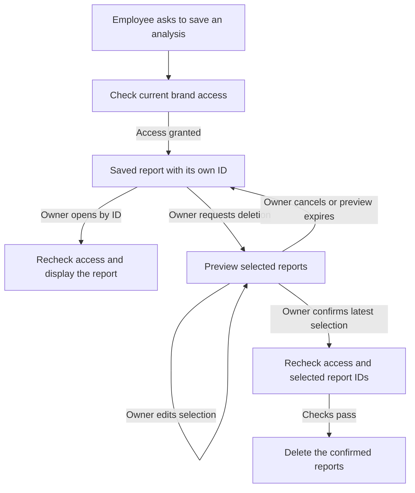

# Saved Reports

An employee can save an analysis as a Markdown report and reopen it by ID. Even the title is visible only to the owner, and only while they have access to every brand in the report. The same rule applies to the CEO.

## Report lifecycle

## Saving and opening a report

When an employee asks to save an analysis, the agent captures the redacted question, the executed SQL (or a reference to it), and the Markdown as the employee saw it. A report names the brands, period and metric, presents the figures from the query, and explains the findings, limitations and recommended actions.

In production, the Reports Service checks current brand access to the referenced results. It writes the redacted report, its evidence references and a save receipt to PostgreSQL in one transaction. If the response times out, a retry looks up the operation key on the receipt and returns the same report ID.

The report record keeps its title, owner, source conversation, brand scope, evidence references and deletion status. The evidence preserves the definition used and the preference version, Golden case revision or turn that supplied it. Saving a revised analysis creates a new ID. An analyst must review it before publication to Golden Knowledge.

## Deletion with confirmation

For “Delete all reports mentioning Client X,” the agent sends `{"search":"Client X"}`. The employee can narrow the search to this conversation, select the conversation on its own, name one report by ID, or explicitly request their whole library. If the scope is unclear, ask. If masking hides the phrase, offer selection by ID.

1. **Review the matches.** Show the count and list each report by title and ID. All start checked. The employee can uncheck reports or use the picker to add others, even when the search found none. Confirmation requires at least one checked report.
2. **Update the preview.** After an edit, the app sends all checked IDs. The service validates them and returns the revised list, count and a new preview ID. The proposed ten-minute window starts with the first preview. New reports appear only if the employee adds them.
3. **Confirm or cancel.** The employee confirms or cancels the latest preview in the authenticated app. Expiry, a stale selection or revoked access requires a fresh preview. Deleted reports disappear immediately. Backups follow the retailer’s retention policy.

### PostgreSQL implementation

Phrase searches match literal text in the title, question or body, ignoring case. Both search and the picker show only active reports the employee owns and has current brand access to.

Store the preview ID, owner, conversation, expiry and decision in `deletion_plans`, with one row per selected report in `deletion_plan_items`. Make `(plan_id, report_id)` unique. Write both tables in one transaction so an incomplete search never produces a preview.

On an edit, lock the pending plan and check its owner, conversation and expiry. Validate every submitted ID against current access and report state, then retire the old preview and save its replacement in the same transaction.

On confirmation, lock the plan, then lock its selected reports in ID order. Take the same per-employee lock used for grant changes. Recheck the plan, access and report state, then mark exactly the checked IDs deleted and record the outcome in one transaction. A count or access mismatch rolls it back. A retry returns the recorded outcome. [PostgreSQL row locking](https://www.postgresql.org/docs/current/explicit-locking.html#LOCKING-ROWS)

## Future enhancements

Library search could help employees find saved reports by topic. Editing could create a new version and check which version the editor opened, so earlier analyses and their evidence remain available.
