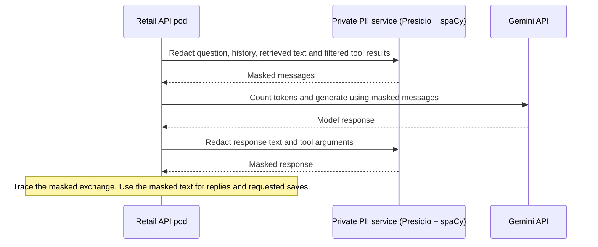

# Brand access and data disclosure

## Identity and brand access

The gateway verifies the corporate OIDC access token, checks the employee’s role and token scopes, and resolves their current brand grants. The SQL tool handler, Reports Service and conversation loader check those grants before releasing data. A manager who loses one brand also loses access to earlier results, summaries and reports covering that brand. An employee with an empty assignment gets no rows. The CEO’s all-brand grant still leaves other employees’ reports private.

BigQuery evaluates permissions for the identity running the job. In the proposed rollout, PostgreSQL maps each brand set to a warehouse reader. The SQL tool handler obtains short-lived credentials for that reader through Google IAM impersonation. The reader needs `bigquery.jobs.create` in the execution project and read access limited by row policies or authorized views. A missing or stale mapping blocks the job. [Query permissions](https://docs.cloud.google.com/bigquery/docs/running-queries#required_permissions) · [Row access policies](https://docs.cloud.google.com/bigquery/docs/row-level-security-intro) · [Authorized views](https://docs.cloud.google.com/bigquery/docs/authorized-views)

Apply brand scope **before joins and aggregation**. In a mixed-brand basket, only the manager’s authorized items contribute to their sales total. On each attempt the SQL tool handler uses SQLGlot to check that the rewritten SQL is one read-only query over approved sources, columns and functions. It uses the same reader for the dry run and execution, with byte, row and time limits. If identity, grants or privacy checks are unavailable, the handler stops the protected operation.

## Private PII service

In production, the application calls an authenticated HTTPS endpoint inside the retailer’s network. The PII service uses Presidio Analyzer with the English spaCy model and retail-specific rules to detect sensitive spans. It replaces those spans and returns the masked text in one response. Only the PII deployment loads the model. The CLI prototype runs the checks in process. [Presidio Analyzer](https://microsoft.github.io/presidio/analyzer/)

The PII endpoint receives raw text. Its callers authenticate with workload credentials, and request and response bodies stay out of service and proxy logs. If redaction fails or times out, the caller stops the operation before sending text to Gemini, tracing it, displaying it or saving it. Instructions in retrieved text cannot grant access or approve actions.

## What can leave the SQL tool handler

The SQL tool handler enforces the retailer’s disclosure rules for columns, groupings and results. A calculation chosen from an employee’s preferences or a Golden example runs within the same warehouse permissions and disclosure limits.

| Data | Handling |
| --- | --- |
| Names, phone numbers, emails and addresses | Exclude from model input, reports and ordinary telemetry. |
| Customer IDs | Withhold by default. For a ranking approved for the employee’s role, return a brand-scoped HMAC pseudonym. |
| Age, fine geography and purchase history | Generalize or omit identifying attributes and aggregate transactions to avoid exposing individual purchase histories. |
| Business measures | Check role and brand access and restrict breakdowns to approved groupings. |

The proposed minimum is **five distinct customers per released cell**, subject to retailer approval. A category with four customers may still be identifiable if the report publishes a parent total and all the other categories. Suppress the complementary values too, or return a coarser breakdown. Across chats and report reads, the handler serializes decisions per employee and metric and checks prior releases in PostgreSQL. If it cannot rule out reconstruction by subtraction, it withholds the breakdown.

Stored evidence and conversation references retain their scope. Reading them requires current grants. Saving requires an explicit request. Deletion requires the owner’s authenticated decision on the final list and another access check at commit. [Report transactions](reports.md#postgresql-implementation)
